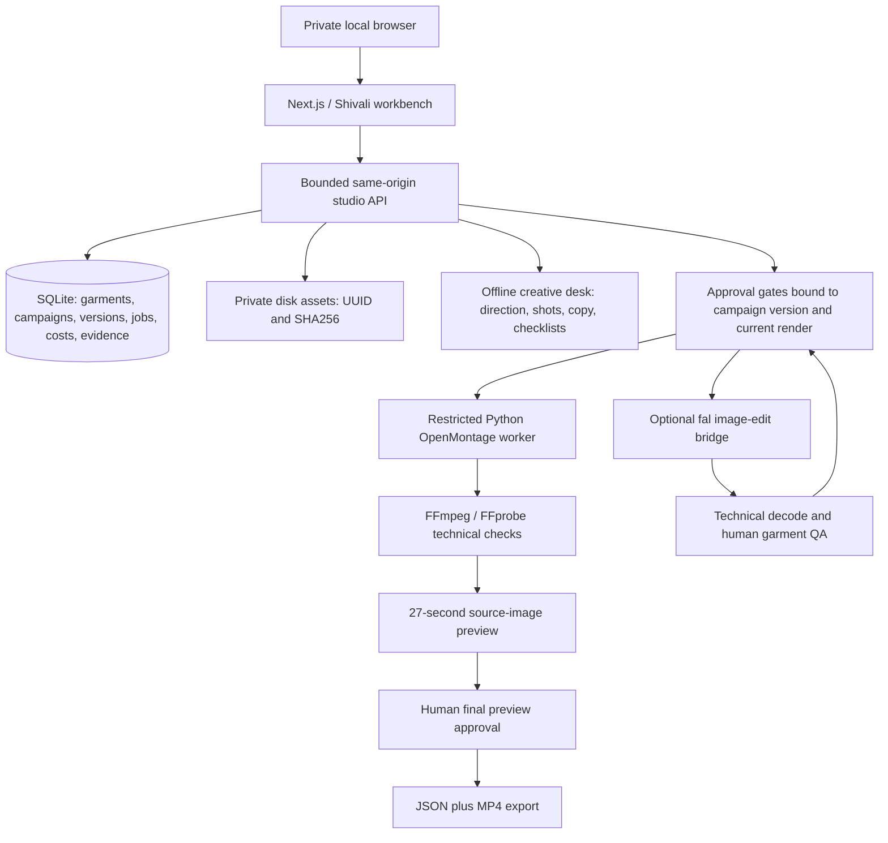

# Architecture

`src/studio/types.ts` holds shared contracts. `core.ts` applies domain transitions; `store.ts` uses synchronous SQLite transactions with a bounded busy timeout. The initial schema stores a versioned state document in SQLite; it trades relational analytics for simple atomic local transitions. Migrate to normalized PostgreSQL tables before large concurrent workloads.

`planning.ts` is explicitly deterministic. It is not an agent model or trend analysis service. Its outputs are editable production briefs; a future LLM tool must use the same artifact and approval contracts. Model image generation is independently configured through fal. No OpenAI credential or API is involved in this release.

Private disk assets are served only by ID. Uploads are bounded before parsing, checked by magic/MIME and UUID-renamed. Approval of media requires FFprobe plus full decoding; images are limited to 40MP and media duration to ten minutes. The app cannot determine product truth from these technical checks. Human garment and music-rights declarations are separate.

Source URLs are saved as evidence, not automatically fetched. The app does not scrape Instagram or assert live trends. The OpenHiggsfield cloud upload route is blocked by default. Server actions for its advanced generator are also blocked unless separately enabled.

Paid jobs require a current approved concept, atomic cost reservation and job creation, then a fresh check immediately before submission. Generated ingestion uses an expected-version transaction. The provider bridge does not retry submissions, fixes queue endpoints, rejects result redirects, restricts downloads to HTTPS fal.media hosts and never returns credential values. Costs remain estimates until a provider invoice is checked.

Local previews use an audited OpenMontage revision and only a scoped local tool registry. The worker is not allowed to load provider tools or .env. When the executor supports network namespaces it uses one; otherwise it strips credentials, denies Python sockets and restricts local FFmpeg protocols. This fallback is defense in depth, not an OS sandbox.

The source worktree is isolated from both original installed checkouts. No external repository push or public deployment is part of this build.
